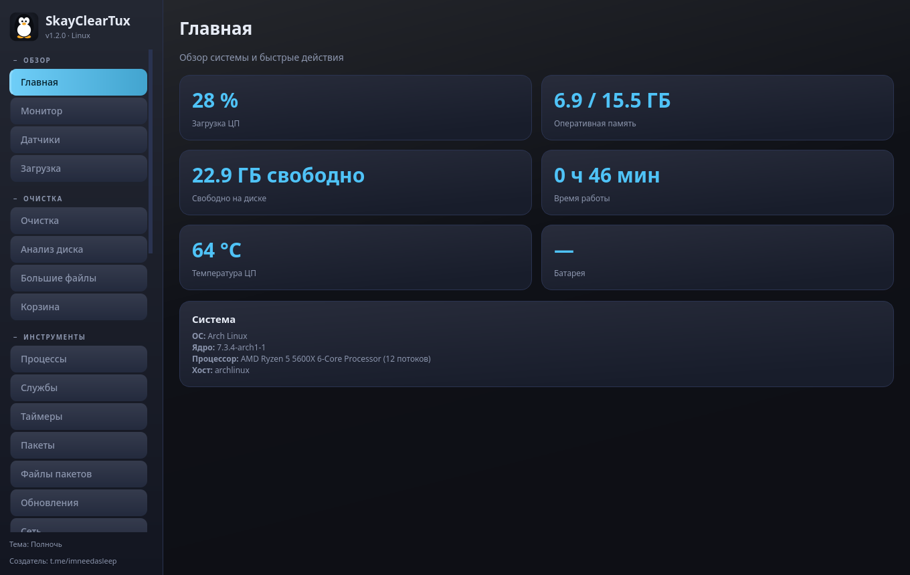

# SkayClearTux

A desktop system toolbox for Linux, macOS and Windows. One Python/PySide6 codebase, native commands per OS, 35 screens in 7 sections. Includes a local chess bot with premoves.

[](https://github.com/skayinray/SkayClearTux/actions/workflows/ci.yml)
[](https://github.com/skayinray/SkayClearTux/actions/workflows/build.yml)
[](LICENSE)



## What it does

- Overview: CPU, memory, disk, uptime, temperatures, battery, health score and HTML report export.
- Cleaning: categorized junk cleanup, disk analysis, large files, trash.
- Tools: processes, services, timers, packages, package files, updates, network, ports, autostart.
- System: hardware, disks/SMART, kernel modules, journal, firewall, diagnostics, tweaks.
- Utilities: notes, hashes, text, backup, passwords, focus timer.
- Chess: local engine, 4 levels, premoves, hints, Elo rating.
- Themes and a command palette (`Ctrl+K`) for jumping between screens.

Unsupported OS features are shown as disabled instead of failing at runtime. The backend layer in `skaycleartux/backends/` uses argument lists, timeouts and native privilege prompts; no `shell=True`.

## Install

Download an AppImage, `.deb`, `.rpm`, Windows zip or macOS dmg from [Releases](https://github.com/skayinray/SkayClearTux/releases).

```sh
chmod +x SkayClearTux-*-x86_64.AppImage
./SkayClearTux-*-x86_64.AppImage
```

On macOS, unsigned builds may need right-click, Open, then Open again. See `docs/images/macos-first-run.png`.

## Updates

The AppImage checks `latest.json` in the latest GitHub release. The manifest is signed with Ed25519 and the public key is compiled into the app. The updater verifies the signature and the SHA-256 digest before replacing the file. TLS verification is never disabled. See [SECURITY.md](SECURITY.md).

## Build from source

Python 3.11 or newer is required.

```sh
python -m pip install -e ".[dev,build]"
python SkayClearTux.py
python -m pytest -q
```

Packaging scripts live in `packaging/01-linux`, `packaging/02-windows` and `packaging/03-macos`. The CI release workflow builds AppImage, deb, rpm, a Windows zip and a macOS dmg, then signs the release manifest and artifacts with the `RELEASE_SIGNING_KEY` secret.

## Layout

- `skaycleartux/` application code, backends, updater and release key.
- `tests/` pytest suite including backend, updater and offscreen UI tests.
- `tools/` smoke test, package-manager check and release signing script.
- `packaging/` OS-specific build scripts and notes.

## License

MIT. See [LICENSE](LICENSE).
