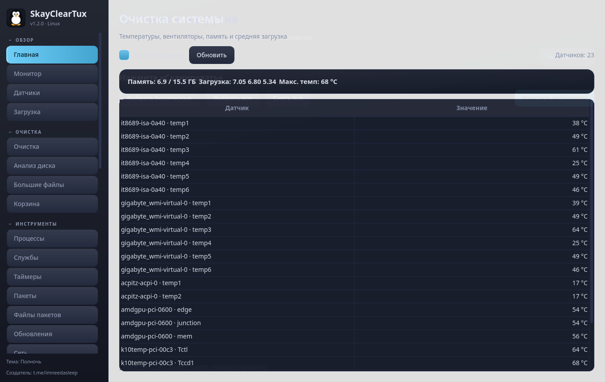
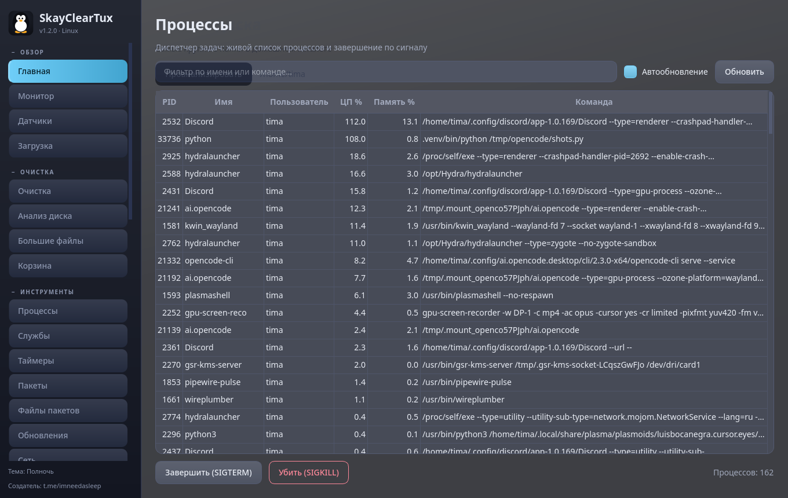
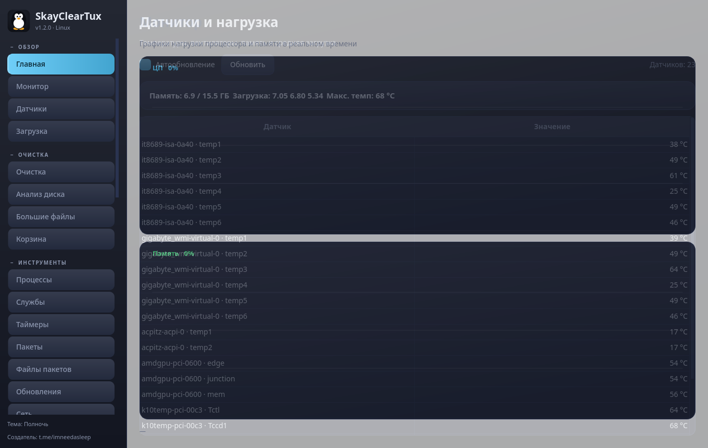
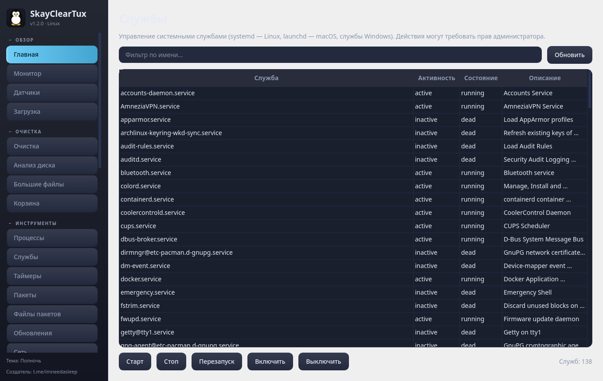
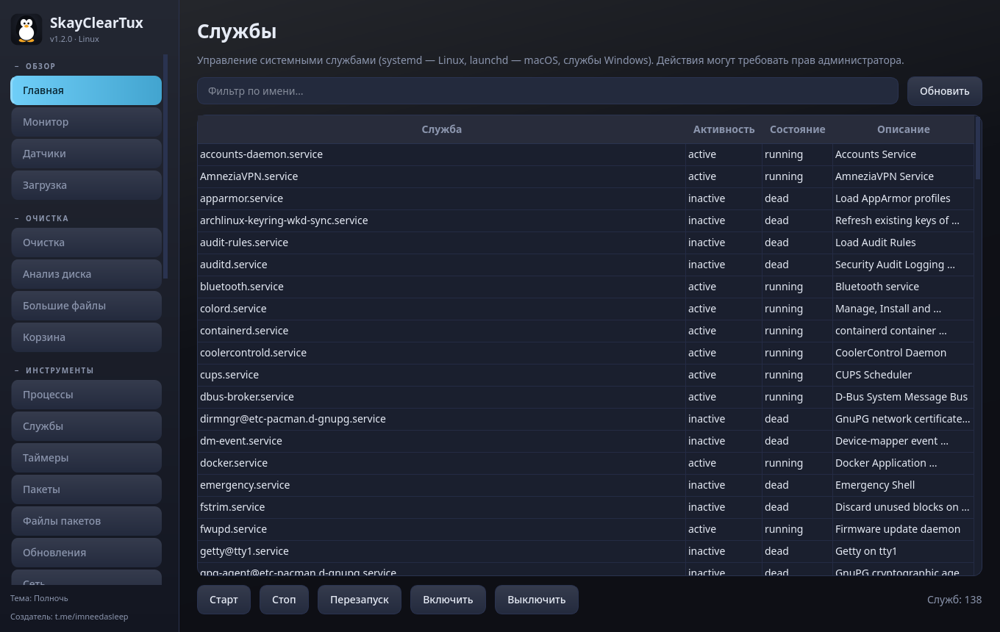
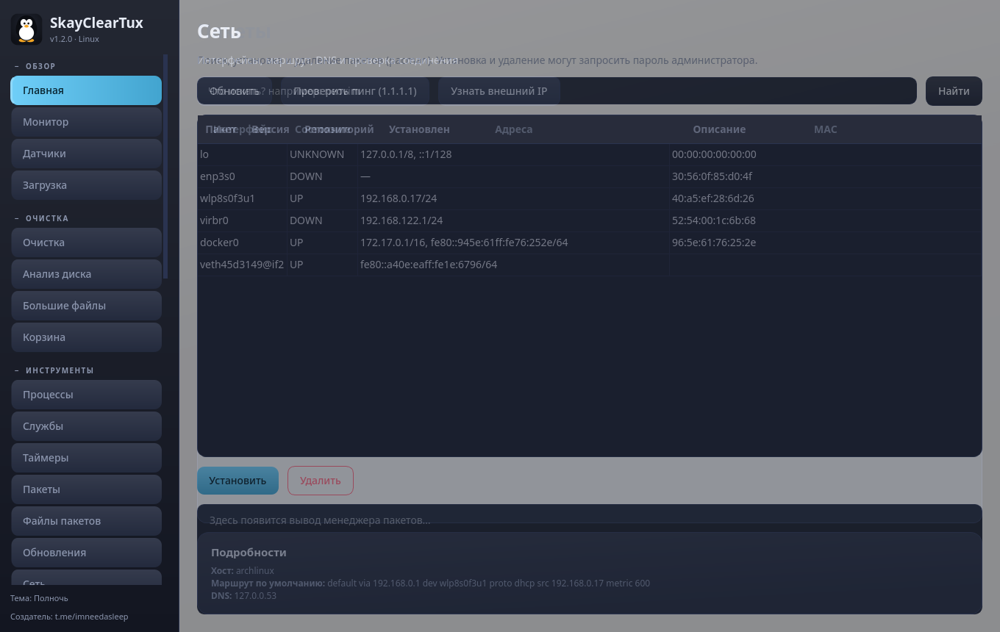
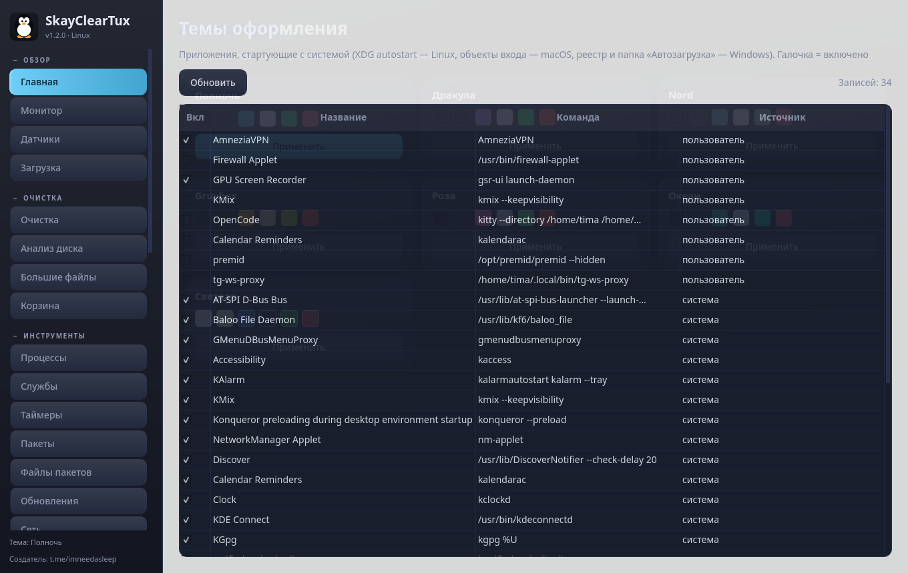
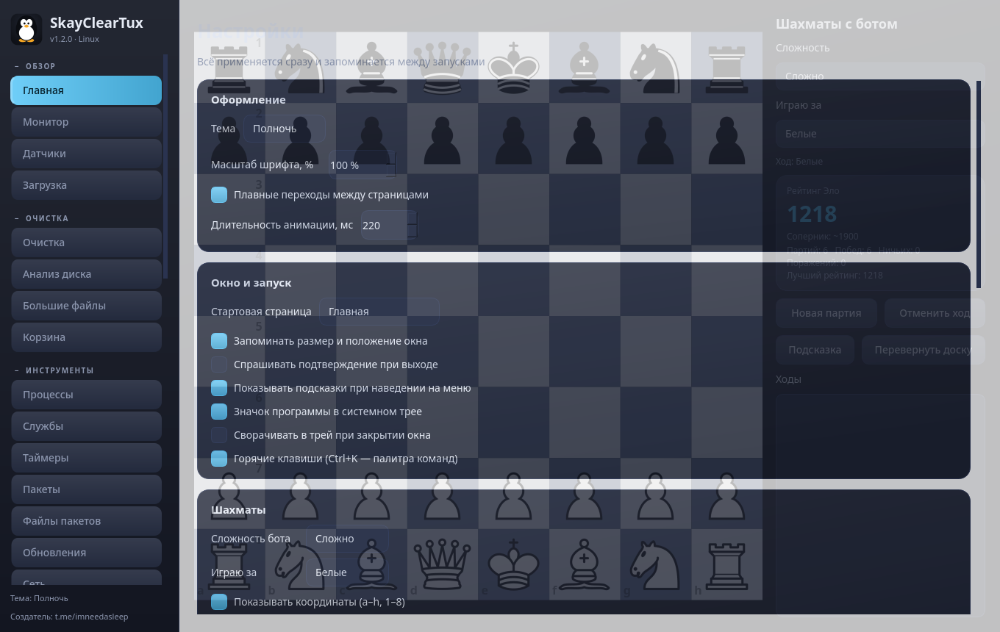

<div align="center">


# SkayClearTux

**Кроссплатформенный системный помощник для ПК**

Очистка системы · мониторинг ресурсов · инструменты · шахматы с ботом

[](https://github.com/skayinray/SkayClearTux/actions/workflows/ci.yml)
[](https://github.com/skayinray/SkayClearTux/actions/workflows/build.yml)
[](LICENSE)
[](https://www.python.org/)
[](https://www.qt.io/)

[Возможности](#возможности) · [Установка](#установка) · [Сборка](#сборка) · [Скриншоты](#скриншоты) · [Участие](CONTRIBUTING.md)

</div>

---

**SkayClearTux** — настольное приложение для **Linux, macOS и Windows**: один и
тот же код и один и тот же интерфейс на всех трёх системах, а системные разделы
(процессы, службы, пакеты, датчики и т. д.) работают через родные для каждой ОС
инструменты. Написан на Python + PySide6 (Qt 6), логотип — **Tux**, талисман Linux.

**Создатель:** [t.me/imneedasleep](https://t.me/imneedasleep)

## Возможности

Всего **34 экрана** в **7 сворачиваемых разделах**. При наведении на пункт меню
появляется подсказка, полный каталог функций — на странице **Справка**, а палитра
команд по `Ctrl+K` позволяет перейти куда угодно за пару нажатий.

| Раздел | Что внутри |
|--------|------------|
| **Обзор** | Главная (ЦП, память, диск, uptime, температура, батарея), Монитор (живые графики), Датчики, Загрузка |
| **Очистка** | Очистка мусора по категориям, Анализ диска, Большие файлы, Корзина |
| **Инструменты** | Процессы, Службы, Таймеры, Пакеты, Файлы пакетов, Обновления, Сеть, Порты, Автозапуск |
| **Система** | Железо, Диски и SMART, Модули ядра, Журнал, Файрвол, Диагностика, Твики |
| **Утилиты** | Заметки, Хэши, Текст, Бэкап, Пароли |
| **Развлечения** | Шахматы с ботом и рейтингом Эло |
| **Настройка** | 7 тем, Настройки, Справка, О программе |

### Кроссплатформенность

| Раздел | Linux | macOS | Windows |
|--------|:-----:|:-----:|:-------:|
| Очистка (категории мусора) | ✅ pacman/apt/dnf/zypper/apk + systemd/Flatpak/Docker | ✅ Homebrew/кэши/Xcode | ✅ `%TEMP%`/кэши/корзина |
| Процессы, службы, автозапуск | ✅ | ✅ `launchctl` | ✅ службы Windows |
| Пакеты и обновления | ✅ `pacman`/`apt`/`dnf`/`zypper`/`apk` | ✅ `brew` | ✅ `winget`/`choco` |
| Сеть и порты | ✅ `ip`/`ss` | ✅ `ifconfig`/`lsof` | ✅ `ipconfig`/`netstat` |
| Датчики, батарея, железо | ✅ `lm-sensors` | ✅ `powermetrics` | ✅ WMI |
| Журнал, диагностика | ✅ `journalctl` | ✅ `log show` | ✅ Журнал событий |
| Модули ядра | ✅ `lsmod` | — | — |
| Твики ядра | ✅ | частично | частично |

Недоступные на конкретной ОС функции аккуратно сообщают об этом и не роняют
программу — за это отвечает слой `skaycleartux/backends/`.

### Полезные мелочи

- **Палитра команд** (`Ctrl+K`) — переход по разделам и запуск действий поиском.
- **Системный трей** — значок с меню и, при желании, сворачивание окна в трей.
- **7 тем** с градиентами, применяются мгновенно.
- **Активность в Discord** — необязательно, свой IPC-клиент без зависимостей.
- **Дистанционные обновления** — проверка JSON-манифеста, скачивание с проверкой
  SHA-256 и самоподмена.
- **Шахматы** — полные правила, 4 уровня, анимация фигур, подсказки и рейтинг Эло.

## Скриншоты

| Главная | Очистка | Процессы |
|:---:|:---:|:---:|
|  |  |  |

| Датчики | Пакеты | Службы |
|:---:|:---:|:---:|
|  |  |  |

| Сеть | Темы | Шахматы |
|:---:|:---:|:---:|
|  |  |  |

## Установка

### Готовые сборки

Скачайте последний релиз со страницы
[Releases](https://github.com/skayinray/SkayClearTux/releases):

| Платформа | Файл | Запуск |
|-----------|------|--------|
| Linux (любой) | `SkayClearTux-1.3.0-x86_64.AppImage` | `chmod +x` и запустить |
| Debian/Ubuntu | `SkayClearTux-1.3.0-amd64.deb` | `sudo apt install ./SkayClearTux-1.3.0-amd64.deb` |
| Fedora/RHEL/openSUSE | `SkayClearTux-1.3.0-x86_64.rpm` | `sudo dnf install ./SkayClearTux-1.3.0-x86_64.rpm` |
| Windows | `SkayClearTux-windows.zip` | распаковать, запустить `SkayClearTux.exe` |
| macOS | `SkayClearTux.dmg` | открыть образ, перетащить в «Программы» |

На Linux пакеты и обновления работают с любым из менеджеров
**pacman / apt / dnf / zypper / apk** — нужный определяется автоматически.

> **Первый запуск на macOS.** Приложение не подписано — щёлкните по нему правой
> кнопкой → **Открыть** → **Открыть**.

### Из исходников

Нужен **Python 3.11+**.

```bash
git clone https://github.com/skayinray/SkayClearTux.git
cd SkayClearTux

python -m venv .venv
# Linux / macOS:
.venv/bin/pip install PySide6
.venv/bin/python SkayClearTux.py

# Windows (PowerShell):
py -m venv .venv
.venv\Scripts\pip install PySide6
.venv\Scripts\python SkayClearTux.py
```

Или установить как пакет:

```bash
pip install .
skaycleartux
```

## Сборка

Готовые скрипты и инструкции для каждой ОС — в папке [`packaging/`](packaging):

| Платформа | Как собрать |
|-----------|-------------|
| Linux (AppImage, `.deb`, `.rpm`) | `packaging/01-linux/` |
| Windows (`.exe`) | `packaging/02-windows/` |
| macOS (`.app` + `.dmg`) | `packaging/03-macos/` |

Готовый CI собирает все три платформы и публикует релиз вместе с `latest.json`
при пуше тега `v*` — см. [`.github/workflows/build.yml`](.github/workflows/build.yml).

## Проверки

```bash
python -m compileall -q skaycleartux SkayClearTux.py
QT_QPA_PLATFORM=offscreen python tools/smoke_test.py
```

`tools/smoke_test.py` поднимает интерфейс без экрана, обходит все страницы,
проверяет бэкенд текущей ОС и ищет символы, которые Qt рисует пустыми квадратами.

## Структура

```
SkayClearTux.py              точка входа
skaycleartux/
  main_window.py             окно, разделы, переходы, палитра команд, трей
  backends/                  кроссплатформенное ядро
    common.py                общие утилиты (запуск команд, права, пути)
    base.py                  интерфейс бэкенда и безопасные заглушки
    linux.py  macos.py  windows.py
    linux_pkg.py             менеджеры пакетов Linux (pacman/apt/dnf/zypper/apk)
  system_tools.py            фасад над бэкендом (весь API страниц)
  cleaner.py                 движок очистки (категории по ОС)
  pages.py                   главная, очистка, анализ диска, темы, о программе
  extra_pages.py             монитор, обновления, железо, журнал, утилиты и т. д.
  tools_pages.py             процессы, службы, пакеты, сеть, датчики, автозапуск
  palette.py                 палитра команд (Ctrl+K)
  helptext.py                описания всех разделов
  settings.py, settings_page.py
  themes.py                  7 тем оформления
  chess_engine.py, chess_widget.py
  discord_rpc.py, updater.py
  assets/                    логотип и шахматные фигуры
packaging/                   сборка под Linux / Windows / macOS
tools/smoke_test.py          дымовой тест интерфейса
.github/workflows/           CI и сборка релизов
```

## Технологии

Python 3 · PySide6 (Qt 6) · собственный шахматный движок (негамакс + альфа-бета).
Шахматные фигуры — набор **Cburnett** (Wikimedia Commons, CC BY-SA 3.0 / GFDL).

## Лицензия

[MIT](LICENSE).
